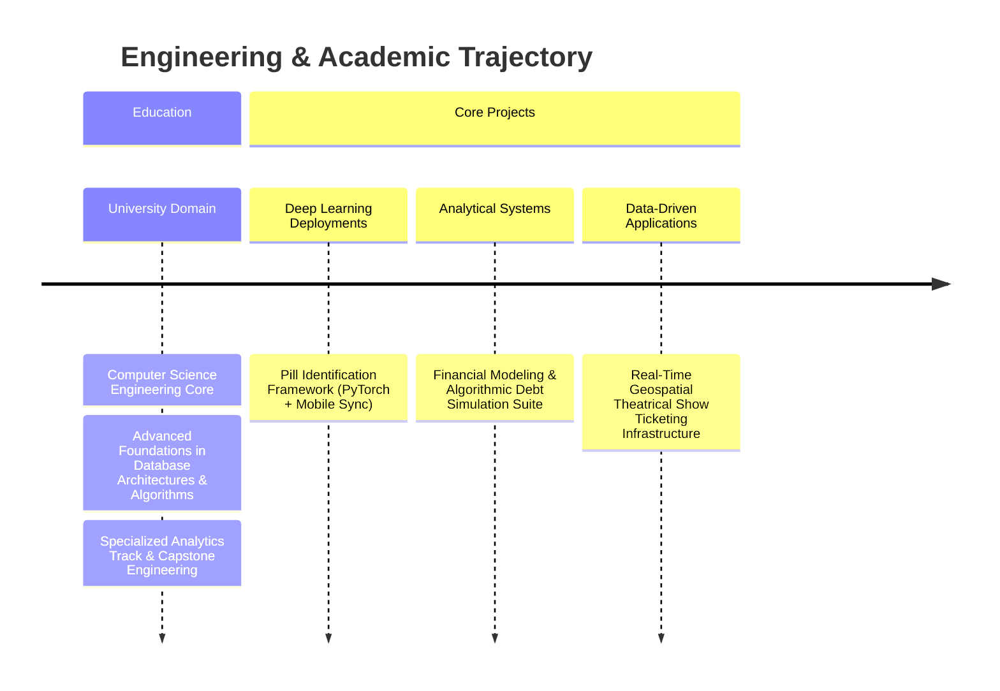

<!-- ================================================================== -->
<!--  RAHUL B — GitHub Profile Command Center                          -->
<!--  Theme: Tokyo Night / Neon-on-Black · Data Analyst · Data Scientist · Data Engineer -->
<!-- ================================================================== -->

<!-- ANIMATED WAVE HEADER -->

  

<!-- NETWORKING COMMAND CENTER -->

  &nbsp;&nbsp;
  &nbsp;&nbsp;
  &nbsp;&nbsp;
  

 

<!-- DYNAMIC TYPING SUBTITLE (fixed: migrated off the dead herokuapp.com domain) -->

  

<!-- GLOWING DIVIDER -->

## 📑 Executive Summary

A data-driven Computer Science Engineer specializing in **Data Analysis, Data Science, and Data Engineering** — turning messy raw data into clean pipelines, predictive models, and decision-ready dashboards. Equally comfortable writing the SQL that feeds a warehouse, training the model that scores it, and shipping the full-stack app that puts it in front of users.

<table border="0" cellpadding="8" cellspacing="0" width="100%">
  <tr>
    <td width="50%" valign="top">
      🧠 <b>Specialized Domains</b> 
      Predictive Modeling · Computer Vision · ETL/ELT Pipeline Design · BI Dashboarding · Financial Data Simulation
    </td>
    <td width="50%" valign="top">
      ⚙️ <b>Architecture Pattern</b> 
      MLOps · Batch &amp; Streaming Data Pipelines · Modular Full-Stack Systems · Real-Time API Sync
    </td>
  </tr>
</table>

<!-- GLOWING DIVIDER -->

## 📊 Live Metrics & KPI Dashboard

  

 

  <table border="0" cellpadding="0" cellspacing="0">
    <tr>
      <td align="center" valign="top" width="50%">
        
      </td>
      <td align="center" valign="top" width="50%">
        
      </td>
    </tr>
  </table>

  <table border="0" cellpadding="0" cellspacing="0">
    <tr>
      <td align="center" valign="top" width="50%">
        
      </td>
      <td align="center" valign="top" width="50%">
        
      </td>
    </tr>
  </table>

<i>Note: the public GitHub-stats/streak instances above are shared community services — if a card ever shows as unavailable, it's almost always a temporary rate-limit on their end, not a broken link. Refreshing the page usually fixes it.</i>

<!-- GLOWING DIVIDER -->

## 🛠️ Specialized Technical Stack

<table border="0" cellpadding="12" cellspacing="0" width="100%">
  <tr>
    <td width="50%" valign="top">
      <h3>📈 Data Analysis &amp; Business Intelligence</h3>
      

        
        
        
        
        
      

    </td>
    <td width="50%" valign="top">
      <h3>🤖 Data Science &amp; Machine Learning</h3>
      

        
        
        
        
        
        
        
      

    </td>
  </tr>
  <tr>
    <td width="50%" valign="top">
      <h3>🗄️ Data Engineering &amp; Big Data</h3>
      

        
        
        
        
        
        
      

    </td>
    <td width="50%" valign="top">
      <h3>💾 Relational &amp; Distributed Databases</h3>
      

        
        
        
        
        
        
        
      

    </td>
  </tr>
  <tr>
    <td width="50%" valign="top">
      <h3>💻 Full-Stack Application Engineering</h3>
      

        
        
        
        
        
        
      

    </td>
    <td width="50%" valign="top">
      <h3>⚙️ MLOps, Cloud &amp; Infrastructure</h3>
      

        
        
        
        
        
        
      

    </td>
  </tr>
</table>

<!-- GLOWING DIVIDER -->

## 💼 Featured Portfolio Projects

<table border="0" cellpadding="10" cellspacing="0" width="100%">
  <tr>
    <td width="50%" valign="top">
      <h3>🔍 AI-Powered Pill Identification Platform</h3>
      
An intelligent mobile application utilizing advanced computer vision to classify and identify pharmaceutical items instantly.

      

        
        
        
      

    </td>
    <td width="50%" valign="top">
      <h3>📈 Advanced Finance Management System</h3>
      
An enterprise-level financial planning engine featuring dynamic mathematical visualizations and deep analytical debt payoff simulations.

      

        
        
        
      

    </td>
  </tr>
  <tr>
    <td width="50%" valign="top">
      <h3>🎬 Real-Time Theatrical Booking Engine</h3>
      
A data-synchronized ticketing interface integrated with localized mapping coordinates and real-time theater show schedule APIs.

      

        
        
        
      

    </td>
    <td width="50%" valign="top">
      <h3>🃏 Dynamic Gaming System Engine</h3>
      
A comprehensive quest tracking and algorithmic dynamic card allocation system built on reactive progressive application layers.

      

        
        
        
      

    </td>
  </tr>
</table>

<!-- GLOWING DIVIDER -->

## 🚀 Professional Timeline

<!-- ANIMATED WAVE FOOTER -->

  Thanks for stopping by — let's build something with data. 🚀

