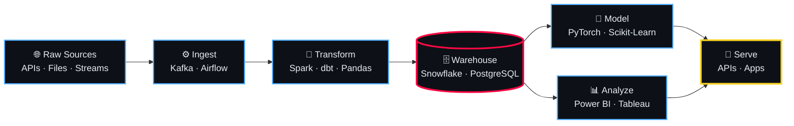
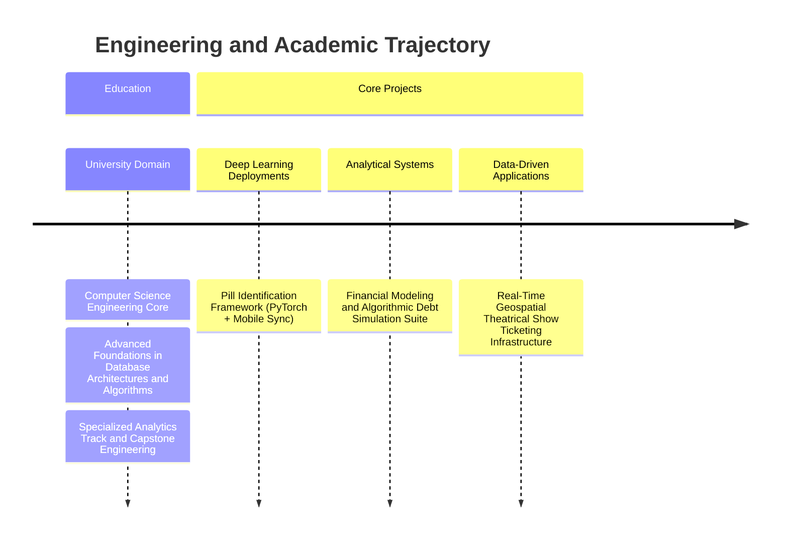

<!-- ================================================================== -->
<!--  RAHUL B — GitHub Profile Command Center  (v2)                     -->
<!--  Theme: Cyber-Holographic / Aurora Borealis · Data Scientist       -->
<!--  Custom animated SVGs live in ./assets (CSS keyframes + SMIL)      -->
<!-- ================================================================== -->

<!-- HERO: custom aurora banner (animated stars, drifting aurora, glitch title, flowing waves) -->

  

<!-- COMMAND CENTER -->

  &nbsp;
  &nbsp;
  &nbsp;
  &nbsp;
  

 

<!-- TYPING SUBTITLE -->

  

<!-- TERMINAL INTRO (types itself out on a loop) -->

  

## 📑 Executive Summary

A data-driven Computer Science Engineer specializing in **Data Analysis, Data Science, and Data Engineering** — turning messy raw data into clean pipelines, predictive models, and decision-ready dashboards. Equally comfortable writing the SQL that feeds a warehouse, training the model that scores it, and shipping the full-stack app that puts it in front of users.

<table border="0" cellpadding="8" cellspacing="0" width="100%">
  <tr>
    <td width="50%" valign="top">
      🧠 <b>Specialized Domains</b> 
      Predictive Modeling · Computer Vision · ETL/ELT Pipeline Design · BI Dashboarding · Financial Data Simulation
    </td>
    <td width="50%" valign="top">
      ⚙️ <b>Architecture Pattern</b> 
      MLOps · Batch &amp; Streaming Data Pipelines · Modular Full-Stack Systems · Real-Time API Sync
    </td>
  </tr>
  <tr>
    <td width="50%" valign="top">
      🔭 <b>Currently Exploring</b> 
      MLOps · Streaming Pipelines · Real-Time Data APIs
    </td>
    <td width="50%" valign="top">
      💬 <b>Ask Me About</b> 
      SQL · Dashboards · ETL · Computer Vision
    </td>
  </tr>
</table>

## ⚡ Live Data Pulse

<!-- Real, auto-updating stats (replaces the old static stock photo) -->

  <table border="0" cellpadding="6" cellspacing="0">
    <tr>
      <td align="center">
        
      </td>
      <td align="center">
        
      </td>
    </tr>
  </table>
   
  
    
  

 

<!-- Contribution snake: generated by .github/workflows/snake.yml (appears after the first run) -->

  <picture>
    <source media="(prefers-color-scheme: light)" srcset="https://raw.githubusercontent.com/Roronoa-Zoro-777/Roronoa-Zoro-777/output/github-contribution-grid-snake.svg" />
    
  </picture>

  
<b>🏆 Trophy Cabinet</b> (click to expand)

   
  

    
  

## 🛠️ Specialized Technical Stack

<table border="0" cellpadding="12" cellspacing="0" width="100%">
  <tr>
    <td width="50%" valign="top">
      <h3>📈 Data Analysis &amp; BI</h3>
      

        
        
        
        
      

    </td>
    <td width="50%" valign="top">
      <h3>🤖 Data Science &amp; ML</h3>
      

        
        
        
        
        
        
        
      

    </td>
  </tr>
  <tr>
    <td width="50%" valign="top">
      <h3>🗄️ Data Engineering</h3>
      

        
        
        
        
        
      

    </td>
    <td width="50%" valign="top">
      <h3>💾 Databases</h3>
      

        
        
        
        
      

    </td>
  </tr>
  <tr>
    <td width="50%" valign="top">
      <h3>🌐 Full-Stack &amp; Web</h3>
      

        
        
        
        
        
      

    </td>
    <td width="50%" valign="top">
      <h3>🧰 Tools &amp; Workflow</h3>
      

        
        
        
        
        
      

    </td>
  </tr>
</table>

<!-- Animated skill meters (bars fill in on a loop) -->

  

## 🧬 How I Build Data Products

## 💼 Featured Portfolio Projects

<!-- TODO: swap each "View repo" link for the real repository URL -->
<table border="0" cellpadding="10" cellspacing="0" width="100%">
  <tr>
    <td width="50%" valign="top">
      <h3>🔍 AI-Powered Pill Identification Platform</h3>
      
An intelligent mobile application utilizing advanced computer vision to classify and identify pharmaceutical items instantly.

      

        
        
      

      

        
🔬 Under the hood

        <ul>
          <li>Image classification model trained in PyTorch</li>
          <li>Mobile sync layer connecting the model to the Android client</li>
          <li>Built for instant, on-demand identification</li>
        </ul>
      

      <a href="https://github.com/Roronoa-Zoro-777?tab=repositories"><b>View repo →</b></a>
    </td>
    <td width="50%" valign="top">
      <h3>📈 Advanced Finance Management System</h3>
      
An enterprise-level financial planning engine featuring dynamic mathematical visualizations and deep analytical debt payoff simulations.

      

        
        
      

      

        
🔬 Under the hood

        <ul>
          <li>Dynamic mathematical visualizations of finances</li>
          <li>Debt payoff simulation engine for comparing scenarios</li>
          <li>Financial data modeling in Python</li>
        </ul>
      

      <a href="https://github.com/Roronoa-Zoro-777?tab=repositories"><b>View repo →</b></a>
    </td>
  </tr>
  <tr>
    <td width="50%" valign="top">
      <h3>🎬 Real-Time Theatrical Booking Engine</h3>
      
A data-synchronized ticketing interface integrated with localized mapping coordinates and real-time theater show schedule APIs.

      

        
        
      

      

        
🔬 Under the hood

        <ul>
          <li>Live show schedules pulled from theater APIs</li>
          <li>Location-aware: mapping coordinates tied to venues</li>
          <li>Node.js backend keeps listings in sync</li>
        </ul>
      

      <a href="https://github.com/Roronoa-Zoro-777?tab=repositories"><b>View repo →</b></a>
    </td>
    <td width="50%" valign="top">
      <h3>🃏 Dynamic Gaming System Engine</h3>
      
A comprehensive quest tracking and algorithmic dynamic card allocation system built on reactive progressive application layers.

      

        
        
      

      

        
🔬 Under the hood

        <ul>
          <li>Quest tracking with progress state</li>
          <li>Algorithmic card allocation logic</li>
          <li>Reactive React front-end</li>
        </ul>
      

      <a href="https://github.com/Roronoa-Zoro-777?tab=repositories"><b>View repo →</b></a>
    </td>
  </tr>
</table>

## 🚀 Engineering Trajectory

## 📡 Let’s Connect

> [!TIP]
> Got a messy dataset, a dashboard that needs to tell a clearer story, or a model that needs shipping? I’d love to hear about it.

  &nbsp;
  
    
  <a href="#top"><kbd>⬆ Back to top</kbd></a>

 

<!-- FOOTER: custom aurora footer -->

  

